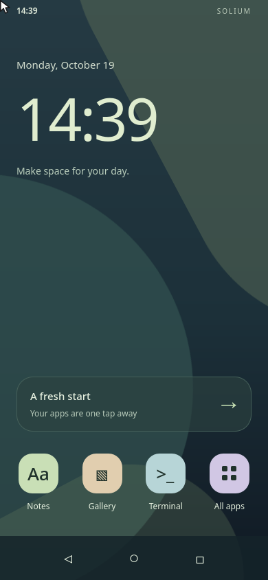
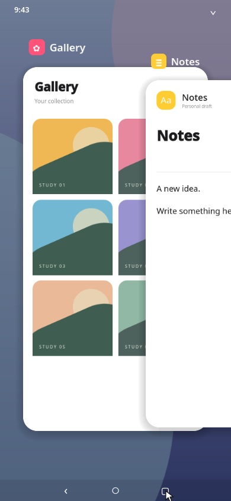
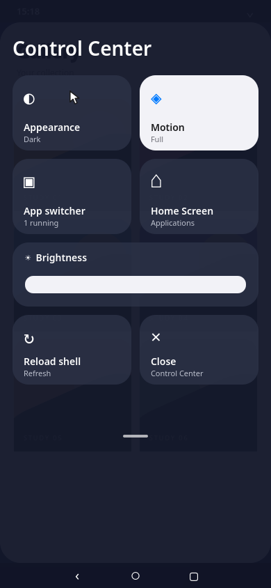
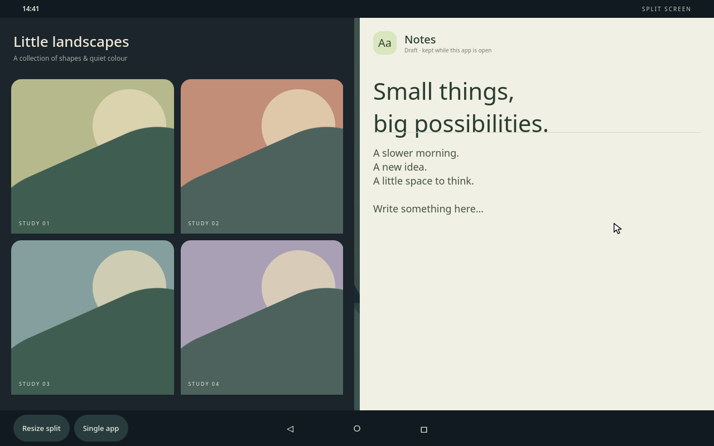
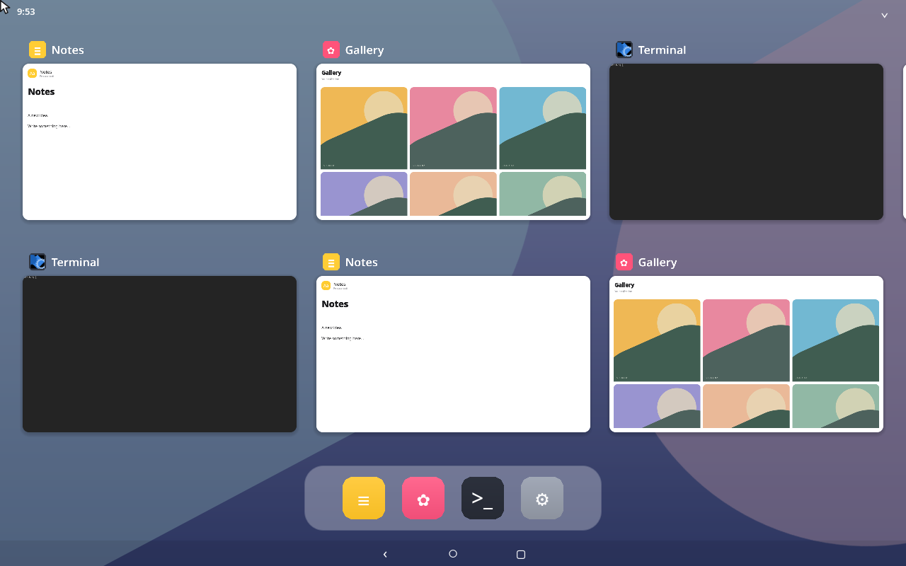

# Mobile shell prototype

An independent Lua/QML shell for a single phone or tablet display. It uses the
same Solium compositor and real Wayland clients as the desktop. The desktop
`init.lua`, default configuration, tiling and workspace scripts are not loaded.



## Behaviour

- **Phone:** one foreground task and a compact **36 px** three-button
  navigation bar. Home parks clients without terminating them; unbound keys
  cannot leak into hidden clients.
- **Home Screen:** applications only. Drag horizontally between pages; the
  first contains the demo apps and Settings, subsequent pages use the live
  installed-app index. Mouse wheels and trackpad scrolling work too.
- **Phone app switcher:** overlapping, rounded **live panes**, with neighbours
  visible at the sides. Drag horizontally or scroll to browse, click a card
  to open it, and swipe a card upward to close it. The right-hand card stays
  above its left neighbour throughout dragging and snapping; focus never
  changes this ordering. No Previous/Next/Open/Close
  buttons. Empty space returns Home. MRU order changes only on activation,
  rather than on browsing.
- **Tablet app switcher:** a continuous horizontal strip in **two rows**,
  typically showing three columns at once in landscape. Scroll or drag by
  any distance, with a short inertial glide on release; there are no pages,
  page indicators or snapping to column boundaries. A dock below opens apps.
  The seventh task simply continues into the next column. Card labels and
  corners remain pane-bound here too.
- **Tablet split screen:** two real clients in split screen. Open Control Center, choose
  **Split screen**, then select the other card. The small navbar controls
  resize the divider or return to one app.
- **Control Center:** pull down from the status bar, click its top-right
  chevron, or open Settings. Appearance, reduced motion, visual brightness,
  Home, task switcher and tablet multitasking controls act on the session.
  Brightness is a compositor overlay, not a hardware backlight change.
  Appearance changes the shell wallpaper; applications retain their themes.
  No simulated Wi-Fi, Bluetooth, battery or media controls are shown.
- **Back:** dismisses Control Center or the switcher, cancels split selection,
  or returns from the root app to Home while preserving its task. In-app
  navigation is the application's own.
- **Home transition:** the shell reports the actual visible icon rectangles,
  tagged with an epoch and output dimensions. Only the foreground app, when
  leaving the app itself, shrinks and fades to its icon; if that icon is on a different page, absent, or stale after a
  resize, the window shrinks below the display instead. The icon cache
  survives a Lua reload, and a fresh Home layout updates it. Leaving Recents
  fades the cards in place, preserving their rectangles and depth. Selecting
  a card expands that app while the other cards fade in place.
- **Swipe close:** the live card remains opaque and flies entirely above the
  output. The native close request is sent only after the compositor's
  closing phase; the scripted 180 ms movement lands before its 190 ms
  deadline. Client refusal/dialog handling remains the native compositor's.
- **Launch:** the QML icon reports its actual rectangle on release. Lua uses
  `sol.present_from` on the launch's loading pane, **before** the application
  maps; adoption keeps the same pane and animation. An origin is consumed
  once. Keyboard launches use a small central fade instead.
- **Window chrome:** both mobile pane styles keep `client.radius: 0`.
  `effects/mobile-corners` reads `self` in the client's `replace` slot and
  cuts an antialiased rounded outline in GLSL, without deforming its pixels.
  QML animates the radius input over 420 ms (instant with reduced motion),
  Lua forwards it as the effect parameter. Geometry, opacity and stacking
  remain native presentations. Identity and shadow layers travel through the
  same pane matrix as the client. No Rust compositor changes are required. The shell draws no duplicate title, icon or
  border positioned beside a separately animated window. Drag updates use
  zero-duration presentation; release snaps with the compositor clock.





Notes is an editable **in-memory draft**, not a persistent notes database.
Gallery is an interactive collection of generated geometric studies, not a
photo-library integration. The status bar shows a real clock; battery,
connectivity and notification data are not invented.



## Start

After building Solium, from the checkout on a Linux Wayland desktop:

```sh
SOLIUM_LUA_INIT="$PWD/crates/solium/lua/mobile.lua" ./target/debug/solium
```

Use the ordinary nested backend first. `SOLIUM_MOBILE_PROFILE=auto` chooses
tablet at a shorter logical side of at least 600 pixels, phone otherwise.
`phone` and `tablet` force either profile. Changes of output size re-evaluate
the layout, including leaving split screen when switching to phone size.
The shell is intentionally scoped to the primary output; external-monitor
desktop behaviour is outside this prototype.

The demo launchers require foot and a Qt Quick `qml` runner on PATH.
`SOLIUM_QML_RUNNER` overrides that runner's executable. Rendering defaults to
the ordinary automatic GPU probe; `SOLIUM_MOBILE_SOFTWARE=1` selects software
QML for headless development.

The supplied mobile entry disables systemd session integration because this
prototype is tested nested. Review session/lock policy before deploying it
as a hardware login session.

## Fedora on macOS

The existing `solium-dev:fc44` image contains the required runtime. The
`solium-mobile-check` container in this workspace uses the original Rust 1.98
toolchain and the `solium-lua-lab-target` volume at `/target`.

```sh
docker exec solium-mobile-check bash dev/lua-lab/build.sh build

# Foreground, private headless sway host; no default Solium configuration.
docker exec -u nobody -e HOME=/tmp solium-mobile-check \
  bash /src/dev/mobile-session.sh phone

# Or tablet; SOLIUM_MOBILE_SIZE=800x1280 also exercises portrait.
docker exec -u nobody -e HOME=/tmp solium-mobile-check \
  bash /src/dev/mobile-session.sh tablet
```

For an interactive VNC session, from this checkout, after the build:

```sh
docker run -d --name solium-mobile-phone \
  -p 127.0.0.1:5902:5900 --user nobody \
  --mount "type=bind,source=$PWD,target=/src,readonly" \
  -v solium-lua-lab-target:/target:ro \
  -e HOME=/tmp -e SOLIUM_VNC=1 -e TZ=Europe/Sofia \
  solium-dev:fc44 bash /src/dev/mobile-session.sh phone
```

Connect a VNC client to `vnc://127.0.0.1:5902`. The port is bound only
to localhost. For a second session use container `solium-mobile-tablet`, port
5903, and the `tablet` argument. Stop them with `docker stop` followed by the
container name. Logs are under `/tmp/solium-mobile-phone` or
`/tmp/solium-mobile-tablet` inside the respective container.

A browser viewer is also available in the current development session at
`http://127.0.0.1:6080/vnc.html?autoconnect=true&resize=scale&reconnect=true`.
It uses Fedora's noVNC/websockify in the separate `solium-mobile-viewer`
container, proxying to the phone VNC socket. Both published ports bind only
localhost. After restarting Solium the page reconnects automatically.

## Controls

| Control | Action |
|---|---|
| Compact chevron / circle / square | Back / Home / App switcher |
| Pull down from status bar / click top-right chevron | Control Center |
| Drag or scroll on Home / switcher | Browse app pages / live windows |
| Swipe a card upward / click it | Close task / open task |
| Super+H / Super+B / Super+Space / Super+A | Home / Back / Switcher / Launcher |
| Super+N / Super+G / Super+Return | Launch Notes / Gallery / Terminal |
| Super+[ / Super+] | Previous / Next task card |
| Super+Shift+S | Split the two most recent tasks, tablet only |
| Super+R / Super+U | Resize split / Single app |
| Super+Shift+R / Super+Shift+Q | Reload / Quit |

## Verification

Two Lua scenarios under `crates/solium/tests/scenarios/` run against real
Wayland clients: phone foreground geometry, Home parking, app drawer/Back,
Recents/selection and phone split rejection; tablet split bounds, ratio changes
and return to single-app mode. The existing runner discovers them dynamically.
Two original script-host regressions reload the actual mobile entry with
kept state and verify MRU/Recents and tablet split/active-task preservation.
Both failed before guarding the entry's initial empty snapshot: a fresh Lua
VM has not received live windows yet, so treating that as an empty desktop
discarded the saved task order and split.

Live button scenarios use actual pointer press/release through `synth::drag`
with equal start/end coordinates. `SOLIUM_CLICK_AT` is deliberately not used:
it calls the Lua click handler and does not exercise hosted QML input.

```sh
bash dev/mobile-smoke.sh phone
bash dev/mobile-smoke.sh tablet
docker exec -u nobody -e HOME=/tmp solium-mobile-check \
  bash /src/dev/mobile-rotation.sh

# The lab helper supplies the existing Fedora Qt/EGL link-order workaround.
docker exec -e SOLIUM_TEST_FILTER=scenario::tests::every_scenario_with_a_client_passes \
  solium-mobile-check bash dev/lua-lab/build.sh test --exact
```

The live rotation run changes the host output through 390x844, 844x390,
1280x800, 800x1280 and back to 390x844. The compositor's own framebuffer is
captured, including intermediate animation frames. Notes input survives Home,
a key typed while Home is visible does not reach hidden Notes, and closing
Notes from Recents leaves the still-running Gallery task.

One compositor defect was fixed: `outputs_resized` previously updated native
output geometry and hosted canvases but never notified Lua. A phone-sized
window could retain the initial tablet policy. It now dispatches `monitors`
then `layout` against the resized bounds before syncing surfaces, like the
hotplug path. `resizing_an_output_notifies_scripts_before_relayout` fails before
the fix and passes after it.

Results on 2026-10-19:

| Check | Result |
|---|---|
| Initial mobile implementation's full test binary | 2042 passed, 3 pre-existing ignored (before the visual revision) |
| Revised policy's twelve script-host regressions | Passed: drag/snap, swipe-close, loading-pane launch origin, shade/settings reload, task/split reload, fixed depth, off-screen close, icon/fallback Home targets, continuous tablet strip and phone overlap |
| Real-client scenario suite | Passed, run in its own process |
| QML scenario suite | Passed, run in its own process |
| Lua/QML loading, Rust formatting, shell syntax | Passed |
| Phone: paged Home, launch from icon, horizontal/vertical card drag, Control Center | Captured through the real pointer path |
| Tablet: card drag, Control Center, split picker and ratio | Captured through the real pointer path |

The Qt scenario suite and client suite are run in separate processes: running
both after initializing Qt in one process aborts in this headless setup. This
revision does not claim another complete all-tests-in-one-process pass.

This verifies a mobile-sized **nested compositor**, with llvmpipe and software
QML. It does not verify a phone's DRM/GPU driver, suspend/power behaviour,
hardware sensors, physical screen rotation, or hardware performance. Touch,
touch gesture navigation, an on-screen keyboard, a lock screen and Android APK
compatibility are outside this iteration. XWayland was unavailable in this
unprivileged container; the tested clients are native Wayland.

## 2026-10-21 interaction revision

The tablet overview is a two-row **strip**, not a paged grid. Verified with
seven real Qt/foot tasks: six are visible initially and the extra column is
reached by continuous scrolling. A policy regression checks that a 100 px
scroll remains exactly 100 px after release. The phone retains the overlapping
carousel with invariant right-over-left depth. Home and swipe-close animations
were captured at 25–35 ms intervals and checked before, during and after exit.



## Source map

- `lua/mobile.lua`: independent entry and host settings.
- `lua/mobile/config.lua`: dimensions, motion and profile selection.
- `lua/mobile/policy.lua`: task ownership, MRU, navigation, real geometry,
  presentation and event handling; state survives Lua reload via `sol.keep`.
- `qml/mobile/`: hosted shell, controls and native QML demo clients.
- `qml/panes/mobile/`: client rounding, pane-bound identity and shadow.
- `qml/loading/mobile.qml`: loading presentation.
- `dev/mobile-session.sh`, `mobile-smoke.sh`, `mobile-rotation.sh`: isolated
  session and reproducible runtime exercises.
